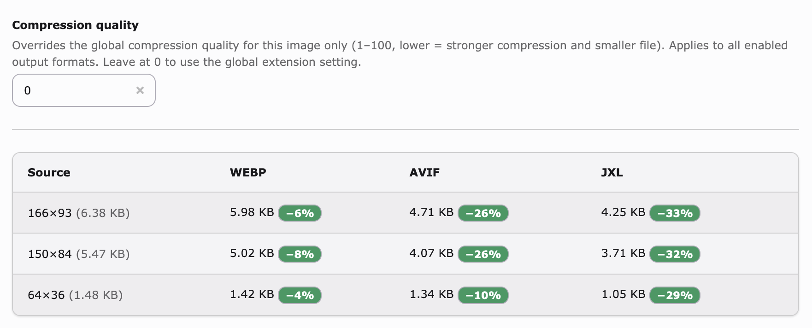

# Compression

[← README](../README.md)

The quality in [`parameters`](Configuration.md#parameters) is the default for the whole site. This page shows how to change it for one image, and how to compress larger variants harder.

## Per-image compression

To change the quality of a single image, edit its metadata in the **Filelist** and pick a **Compression quality mode**:

- *Global* uses the site settings.
- *Force a fixed quality* uses the **Compression quality** value (`1` to `100`) below it, for that file and every enabled format.

If you save *Force a fixed quality* without a value in that range, the mode goes back to *Global*. The extension reads the quality when it converts, so a new mode writes a new sibling on the next render.

Below the field, a read-only report shows the result for each processed variant and format: the size of the sibling and how much it saves compared to the source it replaces. It fills in as the image is rendered at more sizes. A dash means the converter could not produce a smaller file at the current quality.



> [!NOTE]
> Pages that were already rendered keep the old sibling in their cache until they are rendered again. After you change the quality of an image that is in use, flush the affected frontend caches (or wait until they expire) to see the new sibling.

All three fields are TCA exclude fields, so only admins see them by default. To let an editor use them, add *Compression quality mode*, *Compression quality* and *Compression results* to **Allowed excludefields** in their backend user group. Grant all three together. A group that has the quality field but not the mode gets a number it cannot switch on.

## Compress larger variants harder

A responsive site renders the same image at many widths (`480`, `768`, `1200`, `1536`, …). A fixed quality wastes bytes on the large variants. At high pixel density the eye no longer sees compression artifacts: they shrink to noise smaller than a pixel once the image is displayed or scaled down. So you can compress a large variant much harder than a small one, and nobody sees the difference. Image CDNs already do this. imgix, for example, serves about quality **80 at 1×, 40 at 2×, 20 at 3×**. The biggest variants also cost the most to download, so this is where you save the most bytes.

The extension does the same with a **width-to-quality curve** for each output format. The curve is **off by default**, so an upgrade does not change existing output. Paste a curve into the Extension Configuration to turn it on.

### Recommended starting point

Paste these into *Settings → Extension Configuration → webp* (the `basic`, `avif` and `jxl` tabs). They apply to siblings generated from then on:

```
quality_by_width       = 640:80|768:74|1024:70|1536:64|2048:58
quality_by_width_avif  = 640:62|1024:54|1536:48|2048:44
quality_by_width_jxl   = 640:70|1024:62|1536:56|2048:50
```

These values are a **starting point; tune them to your content**. Photos take strong compression well. Flat graphics and text show artifacts sooner. AVIF and JPEG XL look as good as WebP at about 10 to 15 points less, which is why their curves are lower. Only configure the formats you enabled in [`formats_enabled`](Configuration.md#formats_enabled). Leave a setting empty to turn the curve off for that format.

### How it works

Each setting is a list of `maxWidth:quality` bands, separated by `|`. When the extension writes a sibling, it looks at the **width of the rendered variant**. It uses the quality of the smallest band whose `maxWidth` is greater than or equal to that width. A variant wider than the largest band gets the quality of the largest band. The result replaces the `-quality`, `Q=` or `quality=` token in that format's [`parameters`](Configuration.md#parameters).

Example for `quality_by_width = 640:80|1024:72|1536:64`:

| Variant width | Band used | Quality |
|---------------|-----------|---------|
| 480           | `640`     | 80      |
| 700           | `1024`    | 72      |
| 1536          | `1536`    | 64      |
| 2048          | `1536` (widest) | 64 |

**Precedence.** A [quality set for one image](#per-image-compression) always wins for that file, and the curve is not used. Without it, the curve applies. With neither, the extension uses the quality in the format's `parameters` as it is.

**Lossy only.** The curve skips lossless parameters (those that contain `lossless=true`). The default lossless PNG and GIF settings are never changed; only lossy output is scaled.

> [!NOTE]
> Like the quality in `parameters`, a changed curve does not regenerate existing siblings. Clear processed files (*Admin Tools → Maintenance → Remove Temporary Assets*) to apply a new curve.
