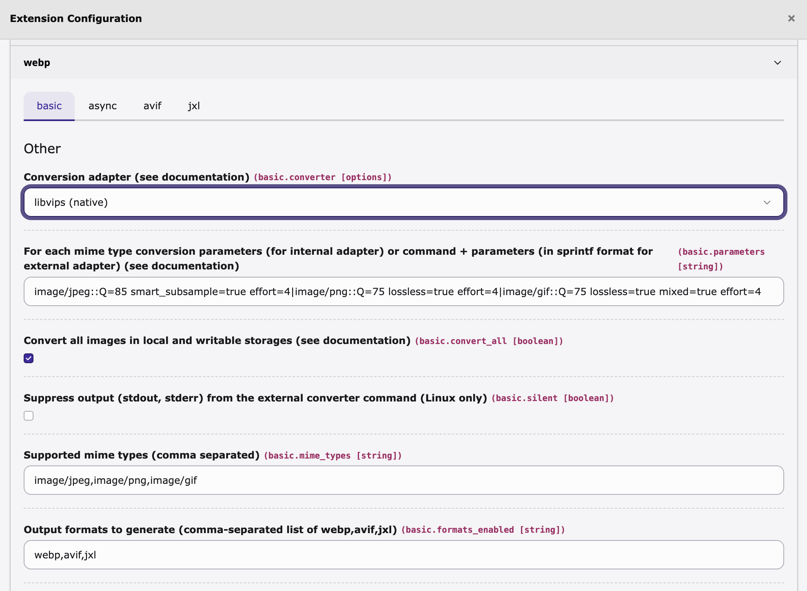

# Configuration

[← README](../README.md)

You find the settings in the Extension Configuration: *System → Settings → Extension Configuration → webp* on TYPO3 v14, *Admin Tools → Settings → Extension Configuration → webp* on v12/v13.



| Setting                                       | Default                                     | Purpose                                                |
|-----------------------------------------------|---------------------------------------------|--------------------------------------------------------|
| [`async`](#async)                             | `0`                                         | Queue conversions for a scheduler worker instead of running them while the page renders |
| [`async_throttle_ms`](#async_throttle_ms)     | `0`                                         | Random sleep (ms) between conversions in the worker; 0 turns it off |
| [`convert_all`](#convert_all)                 | `1`                                         | Convert all images, not just `_processed_`             |
| [`exclude_directories`](#exclude_directories) | _(empty)_                                   | Skip processing for matching paths                     |
| [`filter_pattern`](#filter_pattern)           | `/\.(jpe?g\|png\|gif)\.(webp\|avif\|jxl)$/i`| PCRE for which siblings to hide (only when `hide_webp`) |
| [`formats_enabled`](#formats_enabled)         | `webp`                                      | Output formats to generate, comma list of `webp,avif,jxl` |
| [`hide_webp`](#hide_webp)                     | `1`                                         | Hide generated sibling files (`.webp` / `.avif` / `.jxl`) in the BE file list |
| [`mime_types`](#mime_types)                   | `image/jpeg,image/png,image/gif`            | Source mime types convertible to `webp`                |
| [`parameters`](#parameters)                   | See below                                   | Per-mime-type WebP converter parameters (the `webp` slot) |
| [`parameters_avif`](#parameters_avif)         | See below                                   | Per-mime-type AVIF converter parameters                 |
| [`parameters_jxl`](#parameters_jxl)           | See below                                   | Per-mime-type JPEG XL converter parameters              |
| [`silent`](#silent)                           | `1`                                         | Suppress converter stdout/stderr (Linux only)          |
| [`use_system_settings`](#use_system_settings) | `1`                                         | Reuse GFX color profile settings (MagickConverter)     |

Each format other than WebP adds its own `converter_<format>`, `parameters_<format>` and `mime_types_<format>` settings, on their own `cat=avif` and `cat=jxl` tabs of the form. See [`formats_enabled`](#formats_enabled), [`parameters_avif`](#parameters_avif) and [`parameters_jxl`](#parameters_jxl).

The `quality_by_width` settings are described in [Compression](Compression.md#compress-larger-variants-harder).

## Output formats

### `formats_enabled`

```
# cat=basic; type=string; label=Output formats to generate (comma-separated list of webp,avif,jxl)
formats_enabled = webp
```

A comma-separated list of the output formats this install produces. Each enabled format writes its own sibling next to the original and gets its own row in `sys_file_processedfile`. Set it to `webp,avif` to ship both kinds of siblings, or to `avif,jxl,webp` to ship all three.

Each format other than WebP reads its converter and parameters from its own keys, on the `cat=avif` and `cat=jxl` tabs of the Extension Configuration form:

- `converter_avif`, [`parameters_avif`](#parameters_avif), `mime_types_avif`
- `converter_jxl`, [`parameters_jxl`](#parameters_jxl), `mime_types_jxl`

The WebP slot still uses the original `converter`, `parameters` and `mime_types` keys.

`parameters_avif` and `parameters_jxl` both ship with defaults for ImageMagick, so turning on a format works out of the box on a typical TYPO3 host. Adjust them to your stack. The sections [`parameters_avif`](#parameters_avif) and [`parameters_jxl`](#parameters_jxl) have recipes for libvips and external binaries.

### `mime_types`

```
# cat=basic; type=string; label=Supported mime types (comma separated)
mime_types = image/jpeg,image/png,image/gif
```

The WebP slot only converts source files whose mime type is in this comma-separated list. AVIF and JPEG XL have their own lists, `mime_types_avif` and `mime_types_jxl`.

### `parameters`

Each entry is `mime/type::params`, and `|` separates the entries. The `::` matters: a single colon doesn't match, and the extension then uses the value as the default parameters for every mime type.

Default (ImageMagick/GraphicsMagick):

```
parameters = image/jpeg::-quality 85 -define webp:lossless=false|image/png::-quality 75 -define webp:lossless=true|image/gif::-quality 85 -define webp:lossless=true
```

The same default per mime type:

| Mime type    | Default parameters                          |
|--------------|---------------------------------------------|
| `image/jpeg` | `-quality 85 -define webp:lossless=false`   |
| `image/png`  | `-quality 75 -define webp:lossless=true`    |
| `image/gif`  | `-quality 85 -define webp:lossless=true`    |

Reference:

- [ImageMagick WebP options](https://www.imagemagick.org/script/webp.php)
- [GraphicsMagick options](http://www.graphicsmagick.org/GraphicsMagick.html)

> [!WARNING]
> Try a higher `quality` before you reach for `webp:lossless=true`. Lossless output can be *larger* than the original.

#### Using an external binary

Give a command with exactly two `%s` placeholders, one for the source file and one for the target file:

```
image/jpeg::/usr/bin/cwebp -jpeg_like %s -o %s|image/png::/usr/bin/cwebp -lossless %s -o %s|image/gif::/usr/bin/gif2webp %s -o %s
```

See the [`cwebp` documentation](https://developers.google.com/speed/webp/docs/cwebp).

With the `vips` command line binary of libvips:

```
image/jpeg::/usr/bin/vips webpsave %s %s --Q 85 --effort 4 --smart-subsample|image/png::/usr/bin/vips webpsave %s %s --Q 75 --lossless --effort 4|image/gif::/usr/bin/vips webpsave %s[n=-1] %s --Q 75 --lossless --effort 4 --mixed
```

The GIF entry uses `%s[n=-1]` on the source, so libvips reads all frames. Without it only the first frame survives, and `--mixed` (an option for saving) can't bring the others back. See the [libvips CLI reference](https://www.libvips.org/API/current/using-the-cli.html).

#### Using libvips natively

Pick **libvips (native)** in the converter dropdown for the fastest path. It is 2 to 3 times faster than MagickConverter at the same quality, uses much less memory, and keeps animated GIFs animated in WebP automatically.

Install the libvips shared library, turn on PHP's FFI extension, and require the PHP binding:

```sh
apt install libvips-tools           # Debian/Ubuntu — pulls in libvips42 / libvips42t64
brew install vips                   # macOS
composer require jcupitt/vips
```

Set `parameters` to:

```
image/jpeg::Q=85 smart_subsample=true effort=4|image/png::Q=75 lossless=true effort=4|image/gif::Q=75 lossless=true mixed=true effort=4
```

The options go straight to libvips's `webpsave`. The [option reference](https://www.libvips.org/API/current/VipsForeignSave.html#vips-webpsave) has the full list.

> [!IMPORTANT]
> Set `ffi.enable=true` in php.ini. Do not use `preload`, because jcupitt/vips does not support FFI preloading. On PHP 8.3+ also set `zend.max_allowed_stack_size=-1`. Without it, the default stack limit can make conversions fail for no clear reason.

### `parameters_avif`

The same `mime/type::params|…` syntax as [`parameters`](#parameters). The default is for ImageMagick, which matches the default `converter_avif`:

```
parameters_avif = image/jpeg::-quality 60|image/png::-quality 75|image/gif::-quality 60
```

| Backend             | Recommended `parameters_avif`                                                          |
|---------------------|----------------------------------------------------------------------------------------|
| `MagickConverter`   | `image/jpeg::-quality 60\|image/png::-quality 75\|image/gif::-quality 60`              |
| `VipsConverter`     | `image/jpeg::Q=60 effort=4\|image/png::Q=60 effort=4\|image/gif::Q=60 effort=4`        |
| `ExternalConverter` | `image/jpeg::/usr/bin/avifenc --min 30 --max 50 %s %s\|image/png::…\|image/gif::…`     |

AVIF at a quality of about 60 usually has the same file size as WebP at about 85, often with a better SSIM. For ImageMagick, `-quality` covers the common case. On builds with the libheif AV1 delegate, the encoder also accepts `-define heic:speed=2` (slower, but better compression).

References:

- [libheif AV1 encoder options](https://github.com/strukturag/libheif/blob/master/aom-options.md) (used by ImageMagick when compiled with libheif)
- [libvips `heifsave` reference](https://www.libvips.org/API/current/VipsForeignSave.html#vips-heifsave) (how libvips writes AVIF)
- [`avifenc`](https://github.com/AOMediaCodec/libavif#installation) command line flags

`webp:diagnose` shows how the parameters resolve for each mime type. If you turn on AVIF and entries are missing, it tells you which lines to add.

### `parameters_jxl`

The same syntax. The default is for ImageMagick:

```
parameters_jxl = image/jpeg::-quality 75|image/png::-quality 90|image/gif::-quality 75
```

| Backend             | Recommended `parameters_jxl`                                                                       |
|---------------------|----------------------------------------------------------------------------------------------------|
| `MagickConverter`   | `image/jpeg::-quality 75\|image/png::-quality 90\|image/gif::-quality 75`                          |
| `VipsConverter`     | `image/jpeg::Q=75 effort=7\|image/png::lossless=true effort=7\|image/gif::lossless=true effort=7`  |
| `ExternalConverter` | `image/jpeg::/usr/bin/cjxl --quality 75 %s %s\|image/png::/usr/bin/cjxl --lossless_jpeg=0 %s %s\|…`|

JPEG XL keeps PNG images well in modular (lossless) mode. For `image/png`, use a higher quality than for JPEG (or `lossless=true` on libvips).

References:

- [libjxl encoder options](https://github.com/libjxl/libjxl/blob/main/doc/man/cjxl.txt)
- [libvips `jxlsave` reference](https://www.libvips.org/API/current/VipsForeignSave.html#vips-jxlsave)

## Which images

### `convert_all`

```
# cat=basic; type=boolean; label=Convert all images in local and writable storage and save a copy in Webp format; disable to convert images in the _processed_ folder only
convert_all = 1
```

When on (the default), every image in every local and writable storage gets siblings, in every enabled format. That includes images TYPO3 never processed into `_processed_/`. Turn the checkbox off to convert processed images only.

The siblings next to the originals follow TYPO3's FAL operations. Moving an image moves all its siblings (`.webp`, `.avif`, `.jxl`). Deleting an image removes them. Replacing an image drops the old siblings, and the next render writes new ones. When a storage has a recycler, the siblings go into the recycler with the file, so a restore brings back the whole set. You don't need to configure anything for this.

### `exclude_directories`

```
# cat=basic; type=string; label=Exclude processing of images from specific directories (separated by semicolon)
exclude_directories =
```

Skips images below any of the listed paths. Separate the paths with semicolons.

Example: `/fileadmin/demo/special;/another-storage/demo/exclusive`

## Backend file list

### `hide_webp`

```
# cat=basic; type=boolean; label=Hide sibling files (.webp/.avif/.jxl) matching the filter pattern in backend file list module
hide_webp = 1
```

Hides the generated sibling files (`.webp`, `.avif`, `.jxl`) in the backend file list module. [`filter_pattern`](#filter_pattern) decides **which** files are hidden.

> [!NOTE]
> The setting is called `hide_webp` for backwards compatibility with installs that saved it before AVIF and JPEG XL existed. It covers all sibling formats.

For other behaviour (for example, show siblings only to one backend group), override `$GLOBALS['TYPO3_CONF_VARS']['SYS']['fal']['defaultFilterCallbacks']` in your own extension. `ext_localconf.php` shows how this extension registers its filter.

### `filter_pattern`

```
# cat=basic; type=string; label=Pattern to filter out files
filter_pattern = /\.(jpe?g|png|gif)\.(webp|avif|jxl)$/i
```

A PCRE pattern that the extension matches against the file identifier when [`hide_webp`](#hide_webp) is on. The default matches the sibling names this extension writes (`photo.jpg.webp`, `photo.jpg.avif`, `photo.jpg.jxl`), but not stand-alone `.webp`, `.avif` or `.jxl` files. Change it if you use your own naming scheme.

An invalid pattern is ignored without a message: no files are hidden and no error is raised.

## Converter output

### `silent`

```
# cat=basic; type=boolean; label=Suppress output (stdout, stderr) from the external converter command
silent = 1
```

Hides stdout and stderr of external converters. Linux only.

### `use_system_settings`

```
# cat=basic; type=boolean; label=Use the system GFX "processor_stripColorProfileCommand"/"processor_stripColorProfileParameters" setting for the MagickConverter converter
use_system_settings = 1
```

Only for `MagickConverter`. When on, the extension adds the value of `$GLOBALS['TYPO3_CONF_VARS']['GFX']['processor_stripColorProfileCommand']` and `processor_stripColorProfileParameters` to the converter arguments, so you don't have to repeat it for each mime type.

`PhpGdConverter` and external binaries ignore this setting.

## Async

### `async`

```
# cat=async; type=boolean; label=Enable asynchronous conversion
async = 0
```

When on, the `AfterFileProcessing` listener writes a row to `tx_webp_queue` instead of running the converter during the request. The `webp:process-queue` CLI command then does the conversions later, usually as a TYPO3 Scheduler task. [Async mode](Operations.md#async-mode) describes the setup.

When off (the default), conversions run during the request, as before.

### `async_throttle_ms`

```
# cat=async; type=int+; label=Random sleep (ms) between conversions
async_throttle_ms = 0
```

The worker waits a random time between conversions. `0` means no wait. With a value `N > 0`, each wait is `random(N/2, N*3/2)` milliseconds, so a batch of conversions doesn't load the CPU all at the same moment. This applies to queue mode and to `--folder` mode.
