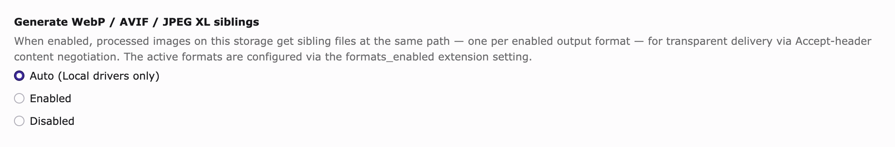

# Operations

[← README](../README.md)

## Updating

After a `composer update`, **save the extension settings at least once** in the Extension Configuration backend module (*System → Settings → Extension Configuration → webp* on TYPO3 v14; *Admin Tools → Settings → Extension Configuration → webp* on v12/v13). TYPO3 only writes default values to `LocalConfiguration` when you save the settings form. New defaults from the updated version have no effect until you do.

### Upgrading to multi-format output

Existing installs keep generating WebP only, because `formats_enabled` defaults to `webp`. To turn on AVIF or JPEG XL:

1. Run the TYPO3 database analyzer once. `tx_webp_queue` and `tx_webp_failed` get a `format` column with the default `'webp'`, so existing rows stay valid without a data migration.
2. Open the AVIF (or JXL) tab in the Extension Configuration, fill in `converter_avif`, `parameters_avif` and `mime_types_avif`, and add the format name to `formats_enabled` (for example `webp,avif`).
3. Update the webserver rewrite rules so they serve the new sibling. See [Webserver configuration](Webserver.md). Without that, the AVIF and JXL siblings sit on disk and nobody gets them.

Custom converters from other vendors that only implement `Plan2net\Webp\Converter\Converter` still work for the WebP slot. To use them for AVIF or JXL, implement `Plan2net\Webp\Converter\MultiFormatConverter` (a separate interface that takes the format as a third argument), or extend `Plan2net\Webp\Converter\AbstractConverter`, which now provides both.

## Async mode

By default the extension converts images during the request that processes the source file. On pages with many images, or on sites with a large fileadmin, this makes every render slower. With `async = 1` the conversion moves out of the render:

1. Set `async = 1` in the extension configuration.
2. Run TYPO3's database analyzer, so it creates `tx_webp_queue`.
3. Add a TYPO3 Scheduler task: **System → Scheduler → Add task → Type: "Process conversion queue (webp)"**. Pick a frequency that matches your load (every minute for busy sites, hourly for sites with little traffic).
4. Make sure the scheduler itself runs, either with `vendor/bin/typo3 scheduler:run` in cron or with a runner that stays in the background.

From then on, the listener queues new conversions and the scheduler runs them in the background. Existing siblings keep working. Images without a sibling yet get converted the next time they are rendered.

### Sweeping folders outside FAL

Some image folders are outside TYPO3's File Abstraction Layer, so the listener never sees them. The main example is `typo3temp/assets/online_media/` with the preview images for YouTube and Vimeo. The `--folder` argument skips the queue and converts the files directly:

```sh
vendor/bin/typo3 webp:process-queue --folder=typo3temp/assets/online_media/
```

Add this as a second Scheduler task ("Execute console command") if you want it to run regularly. Paths are relative to the public web root, and for safety they must stay inside it.

## Remote storages (S3, Azure, custom FAL drivers)



By default every writable storage with the Local driver gets sibling files. That is the default mode of the *Generate WebP / AVIF / JPEG XL siblings* field on each storage record. To turn on a storage with another driver (an S3 mount, an Azure mount, any custom FAL driver), edit the storage record and set the field to **Enabled**.

| Value | Result |
|---|---|
| **Auto** *(default)* | On for `driver = Local`, off for everything else. Identical to pre-14.2 behaviour. |
| **Enabled**          | On regardless of driver type. Use to opt a remote storage in. |
| **Disabled**         | Off regardless of driver type. Use to take a Local storage out of the pipeline temporarily. |

Once enabled, the storage works like a Local storage: every sibling lands at `<original>.<format>` on the storage, and the four FAL lifecycle events (move, replace, delete, recycler) keep all siblings in sync.

> [!IMPORTANT]
> Turn on [`async = 1`](Configuration.md#async) for every storage that doesn't use the Local driver. Without it, every page render that processes an image waits for the driver's upload (a typical S3 PUT takes 100 to 500 ms, more on cold connections). The async queue moves that work out of the render.

### Serving the right format on a CDN

The extension *writes* the siblings to the storage. Sending the right one for each request (the `Accept` header rewrite) is the job of the edge. Some outlines:

- **CloudFront**: add a CloudFront Function on viewer request that reads `Accept`. Pick `.avif` if it is there, else `.webp`, else `.jxl` for clients that prefer it (Safari 17+), and otherwise serve the original. Add a viewer response function that sets `Vary: Accept`.
- **Cloudflare**: a Worker with the same order, or an Image Resizing policy if the account has it.
- **Direct S3 origins without an edge function**: not supported by S3 itself. You need a layer in front (CloudFront or similar, or an origin proxy).

The [webserver rules](Webserver.md) still apply when TYPO3's origin is in front of the storage (for example, S3 is mounted only for backend uploads, and files are served through the TYPO3 instance).

## Removing siblings

To remove all generated sibling files (for example before you change the converter or the quality):

1. Open *System → Maintenance → Remove Temporary Assets* (TYPO3 v14) or *Admin Tools → Maintenance → Remove Temporary Assets* (v12/v13).
2. Click *Scan temporary files*.
3. Click the button with the storage path on it.

The button only mentions `_processed_/`, but it removes all processed files in the storage, including the siblings of every format.

The next page render writes siblings again for every enabled format, with the current configuration.
