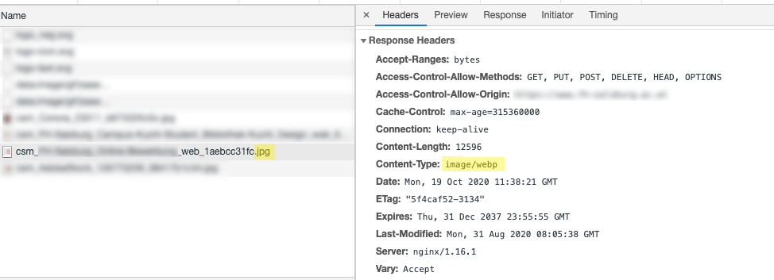

<p align="center">
  
</p>
<h1 align="center">WebP / AVIF / JPEG XL for TYPO3 CMS</h1>
<p align="center"><em>Modern image formats for the browsers that support them. Your URLs and your HTML stay the same.</em></p>

<p align="center">
  <a href="https://packagist.org/packages/plan2net/webp"></a>
  <a href="https://packagist.org/packages/plan2net/webp"></a>
  <a href="https://github.com/plan2net/webp/actions/workflows/tests.yml"></a>
  <a href="https://get.typo3.org/"></a>
  <a href="https://packagist.org/packages/plan2net/webp"></a>
  <a href="LICENSE"></a>
</p>

## The idea

The extension writes sibling files next to every processed image: `photo.jpg.webp`, `photo.jpg.avif` and `photo.jpg.jxl`. For each request, your webserver reads the browser's `Accept` header and sends the best sibling that browser accepts. A browser that accepts none of the modern formats gets the original JPEG, PNG or GIF.

```
csm_foo-bar_4f3d6bb7d0.jpg            ← TYPO3 variant
csm_foo-bar_4f3d6bb7d0.jpg.webp       ← formats_enabled contains webp
csm_foo-bar_4f3d6bb7d0.jpg.avif       ← formats_enabled contains avif
csm_foo-bar_4f3d6bb7d0.jpg.jxl        ← formats_enabled contains jxl
```

You pick any combination of formats with the [`formats_enabled`](Documentation/Configuration.md#formats_enabled) setting. WebP is on by default.

> [!NOTE]
> The Composer package is still `plan2net/webp` and the TYPO3 extension key is still `webp`. We kept the names for backwards compatibility with more than 1.5M existing installs. The extension supports all three formats anyway.

## This extension or TYPO3 core?

TYPO3 core can also produce modern formats, but it solves a different problem. The difference is how the image is delivered, not which formats exist:

- **WebP** is a processing format since TYPO3 v13.0.
- **AVIF** is a processing format since TYPO3 v13.4, but only with **ImageMagick** and **not by default**. GraphicsMagick has no AVIF support, so core only turns it on when ImageMagick reports that it can write AVIF (or when you add `avif` to `imagefile_ext` yourself).
- TYPO3 **v14** added `$GLOBALS['TYPO3_CONF_VARS']['GFX']['imageFileConversionFormats']`, a map from input to output format (for example `'jpg' => 'webp'`, `'default' => 'avif'`).

In every core variant the processed file gets a new extension, and so a new URL (`photo.jpg` becomes `photo.webp` or `photo.avif`). This extension writes sibling files next to the original instead, and the webserver picks one per request. The URL never changes.

| Concern                                                | This extension                                                                                  | TYPO3 core                                                  |
|--------------------------------------------------------|-------------------------------------------------------------------------------------------------|-------------------------------------------------------------|
| Formats supported                                      | WebP, AVIF, JPEG XL                                                                             | WebP (13.0+), AVIF (13.4+, ImageMagick), **no JPEG XL**     |
| URL of served image                                    | Unchanged (`photo.jpg`)                                                                         | Changed (`photo.webp` / `photo.avif`)                       |
| HTML / templates                                       | Unchanged                                                                                       | Reference new URL                                           |
| Fallback for browsers that lack the served format      | Handled by the webserver                                                                        | Need `<picture>` or polyfill                                |
| Requires webserver rewrite rule                        | Yes                                                                                             | No                                                          |
| Works with cached HTML / CDN URLs                      | Yes                                                                                             | Cache invalidation needed                                   |

Use the core feature if you can change URLs. Use this extension if URLs must stay the same (cached HTML, CDN, stable references), if you want each request to fall back to the original on its own, or if you want **JPEG XL**.

Other options:

- **Apache `mod_pagespeed` / nginx `ngx_pagespeed`**, Google's modules that rewrite images automatically. `pagespeed EnableFilters convert_jpeg_to_webp;` plus `convert_to_webp_lossless;` gives the same result, but they are harder to set up and to run.
- **Cloudflare Polish** or a similar image optimisation at the CDN.

## Getting started

You need an image converter on the host that can write each format you enable. [Formats and converters](Documentation/Formats.md#requirements) lists what to install.

```sh
composer require plan2net/webp
```

Then:

1. Activate the extension if your TYPO3 runs in non-Composer mode. Composer mode activates it automatically.
2. Flush the TYPO3 and PHP caches.
3. Clear processed files (*System → Maintenance → Remove Temporary Assets* on TYPO3 v14; *Admin Tools → Maintenance* on v12/v13).
4. Add the [webserver rewrite rules](#webserver-configuration).

WebP works with the default settings. To also generate AVIF or JPEG XL, see [Configuration](Documentation/Configuration.md#formats_enabled).

## Webserver configuration

Let the extension write the rules for you:

```sh
./vendor/bin/typo3 webp:webserver-config --server=nginx    # or apache / caddy
```

It prints a snippet for **your** enabled formats and source types, with the formats already in the right order (AVIF, then WebP, then JPEG XL). Paste it into your server or vhost configuration.

[Webserver configuration](Documentation/Webserver.md) shows the full rules for [nginx](Documentation/Webserver.md#nginx), [Apache](Documentation/Webserver.md#apache) and [Caddy](Documentation/Webserver.md#caddy), together with the variants the command points to: [Cloudflare](Documentation/Webserver.md#behind-cloudflare), [restrict by user agent](Documentation/Webserver.md#restrict-by-user-agent-optional), and [Apache when `%{REQUEST_FILENAME}` doesn't resolve](Documentation/Webserver.md#when-request_filename-doesnt-resolve).

## Check that it works

Check two things: the siblings exist for every format you enabled, and the webserver sends the right one to a browser that supports it.

**The siblings.** Open `fileadmin/_processed_` and look for siblings next to the processed variants, as in the listing in [The idea](#the-idea). With `convert_all = 1` you also find siblings next to the originals in `fileadmin/` itself.

**The delivery.** Request a JPEG or PNG with an `Accept` header for each enabled format:

```sh
# Expect Content-Type matching the highest-priority enabled format the client asked for:
curl -H "Accept: image/avif,image/webp,image/jxl" -I https://example.tld/fileadmin/_processed_/b/2/csm_foo-bar_4f3d6bb7d0.jpg
# expect: Content-Type: image/avif   (or image/webp if only webp is enabled, etc.)
```

Or open the URL in a browser and look at the response headers in the developer tools. The URL ends in `.jpg`, but the `Content-Type` should be one of the modern formats:



If something is missing, run `vendor/bin/typo3 webp:diagnose`. It checks the whole chain and points at the first link that fails. See [Troubleshooting](Documentation/Troubleshooting.md).

## Compatibility

| Extension version | TYPO3              | PHP                 | Status   |
|-------------------|--------------------|---------------------|----------|
| 14.x              | 12.4, 13.4, 14.x   | 8.2, 8.3, 8.4, 8.5  | Current  |
| 13.x              | 13.4               | 8.2, 8.3            | Legacy   |
| 5.x               | 12.4               | 8.1, 8.2            | Legacy   |

## Documentation

| Document | What it covers |
|---|---|
| [Formats and converters](Documentation/Formats.md) | the three formats, which converter writes which format, what to install, the extra CPU and disk it costs |
| [Configuration](Documentation/Configuration.md) | every extension setting, converter parameters for ImageMagick, libvips and external binaries |
| [Compression](Documentation/Compression.md) | a fixed quality for one image, harder compression for larger variants |
| [Webserver configuration](Documentation/Webserver.md) | nginx, Apache and Caddy rules, Cloudflare, user agent rules |
| [Operations](Documentation/Operations.md) | updating, enabling AVIF and JPEG XL, async mode, folders outside FAL, remote storages and CDNs, removing siblings |
| [Troubleshooting](Documentation/Troubleshooting.md) | `webp:diagnose`, common problems, very large originals, sharpness, known limitations |
| [CHANGELOG.md](CHANGELOG.md) | what changed in each release |

## Credits

Inspired by [Angela Dudtkowski](https://www.clickstorm.de/agentur/)'s `cs_webp` extension. Thanks Angela.

Thanks to Xavier Perseguers for the Cloudflare hint and to Marcus Förster for simplifying the Apache rewrite rules.

## License

GPL-3.0-or-later. See [LICENSE](LICENSE).

## Spread some love

Send us a postcard from your favourite place and tell us how much you love TYPO3 and OpenSource:

> plan2net GmbH
> Sieveringerstraße 37
> 1190 Vienna, Austria
